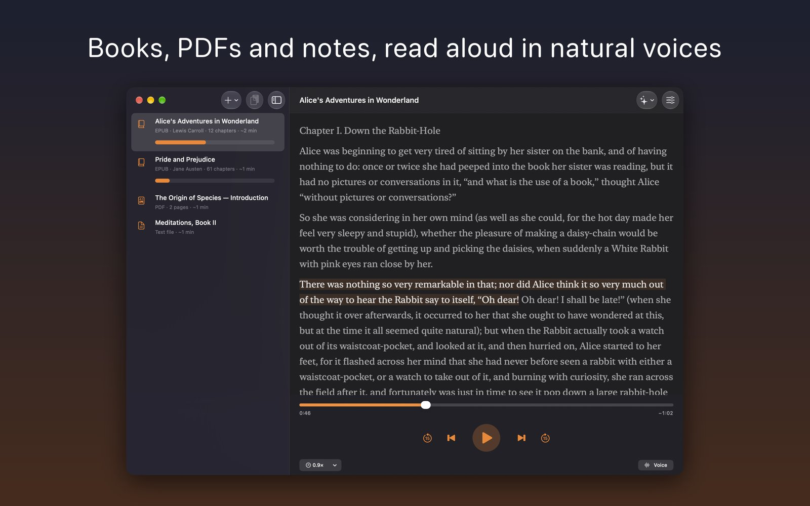

# Talebright

Books, PDFs and notes read aloud in natural voices that run entirely on your device. For Mac, iPhone and iPad.

**App Store** (coming soon) · [Website](https://perseus-sepahi.github.io/software/talebright/) · [Support](https://perseus-sepahi.github.io/software/talebright/support/)

## What it does

Talebright reads PDFs, EPUBs and anything you paste in natural neural voices: 28 Kokoro voices and
37 Phonon narrator and character voices, all bundled with the app and running offline. The sentence
being read is highlighted and the page follows along.

- **Clone a voice** from a ten-second recording, a voice note or a video. Talebright separates the
  voice from music and background noise and finds each person speaking.
- **RVC voice models**: add a `.pth` (and its `.index`) and any document is read in that voice.
- **Podcasts and speeches**: turn a document into a two-host podcast or a talk, written by Apple
  Intelligence on your device.
- **Narrators**: save a voice, speed and pitch together.

## Price

Free to download, and every voice and feature is free for 7 days. After that, the neural voices,
cloning and podcasts need **Full Access**, a one-time US$1.99 purchase that works on all your Apple
devices. Your library and reading with Apple's built-in voices stay free. No subscription, no account.

## Privacy

No accounts, no analytics, no tracking. Every voice runs on your device and nothing you read is
uploaded. [Privacy policy](https://perseus-sepahi.github.io/software/talebright/privacy/).

Only clone your own voice or a voice you have the speaker's permission to use.

## Requirements

- Mac: macOS 15 or later, Apple silicon.
- iPhone and iPad: iOS and iPadOS 18 or later.
- Podcasts and speeches need Apple Intelligence (macOS or iOS 26 or later).

## Reporting bugs

Open an [issue](https://github.com/perseus-sepahi/talebright-app/issues). Include your device, its
OS version, the app version, and the steps that reproduce the problem.

## Source code

Talebright is not open source. This repository holds the releases, the issue tracker and the
documentation only.

## Licence

See [LICENSE.md](LICENSE.md). Bundled models and libraries and their licences are listed in
[THIRD-PARTY-NOTICES.md](THIRD-PARTY-NOTICES.md).

© 2026 Perseus Sepahi
